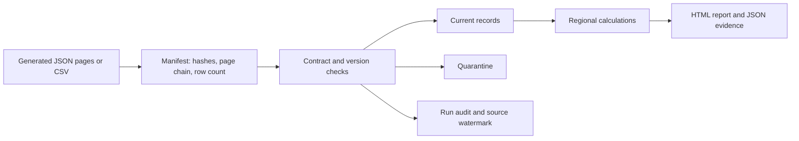

# Oracle Fusion Data Engineering Portfolio

**Deep Samaddar · APAC, EMEA & Americas**

[](https://github.com/Deepsamaddar/oracle-fusion-data-engineering-portfolio/actions/workflows/ci.yml)

I built this portfolio to work through three practical questions: which purchase orders need attention, which supplier invoices are overdue, and which journals need review before month-end close. I wanted the pipeline to handle reruns and imperfect data as carefully as the financial calculations.

This is my original, AI-assisted portfolio implementation using fictional data and Oracle Fusion–inspired extraction patterns. It runs locally without an Oracle account. The regional cases are design scenarios, not client deployments or employment claims.

## Three project scenarios

| Scenario | Business question | Implemented result |
|---|---|---|
| [APAC procurement](docs/scenarios.md#apac-procurement) | Are receipts and invoice prices consistent with the order? | Quantity and price exceptions; open commitments in INR, SGD and AUD |
| [EMEA payables](docs/scenarios.md#emea-payables) | What is outstanding, and how old is it? | Invoice aging in EUR, GBP and AED; late arrivals and payment updates |
| [Americas month-end close](docs/scenarios.md#americas-month-end-close) | Do journals balance within their own ledger and currency? | Debit/credit controls across USD, CAD and BRL |

## Run it

Python 3.10–3.12; standard library only. No credentials, paid services or dependency installation required.

```bash
python -m unittest discover -s tests -v
python -m fusion_portfolio.demo --out artifacts/demo --rows 300
# Repeat the same batch to demonstrate safe replay:
python -m fusion_portfolio.demo --out artifacts/demo --rows 300
```

Open `artifacts/demo/report.html` in a browser. The run also produces `summary.json`, a SQLite warehouse, and synthetic landing files with manifests. Use a new output directory for a fresh baseline. `--rows` must be an even integer of at least two.

## Verified demonstration

With 300 base records per scenario and reference date **23 October 2026**:

| Measure | Result |
|---|---:|
| Automated tests | 28 passed locally |
| Current warehouse records after incremental load | 901 |
| Invalid/duplicate input rows quarantined | 9 |
| APAC records with one or more exceptions | 113 |
| EMEA overdue invoices | 229 |
| Americas journals checked / unbalanced | 150 / 15 |

The EMEA incremental batch updates one invoice and inserts one late record. Replaying the extracts adds no records or audit runs. These are synthetic control results, not measured savings or production volumes. GitHub Actions checks Python 3.10, 3.11 and 3.12; the live badge above shows its current status.

## How the pipeline works



The loader verifies the complete extract before writing. A SQLite transaction commits accepted records, rejected rows, audit results and watermarks together. Newer versions replace older ones; stale versions cannot overwrite current data. Equal timestamps with conflicting contents are quarantined. A watermark records progress but never silently discards a late-arriving record.

Amounts use Python `Decimal`. Totals stay in their original currency. Journal checks are scoped by ledger, period, journal and currency. An identical manifest is recognized by its content hash and returns the original run summary.

## Explore the work

- [Regional scenarios and data contracts](docs/scenarios.md)
- [Oracle source mapping and production design](docs/oracle-mapping.md)
- [Validation, limitations and interview notes](docs/validation-and-interview.md)
- [SQL warehouse controls](sql/warehouse_checks.sql)
- [Compact demo evidence](examples/metrics.json)
- [Implementation](fusion_portfolio/engine.py) and [tests](tests/test_portfolio.py)

## Scope

The executable part starts at a **canonical landing contract**. JSON pages resemble paginated REST extracts; CSV files resemble a bulk extract after mapping. They are not raw Oracle API responses. Live authentication, source joins, network retry logic, OCI deployment, tax rules, FX conversion and production-scale processing are outside this implementation. See the mapping notes for what would be required to connect a tenant.

**Project owner: Deep Samaddar.** Original portfolio code, developed with AI assistance. MIT licensed; Oracle documentation is referenced for integration context, and Oracle product names remain their respective owners’ trademarks.
